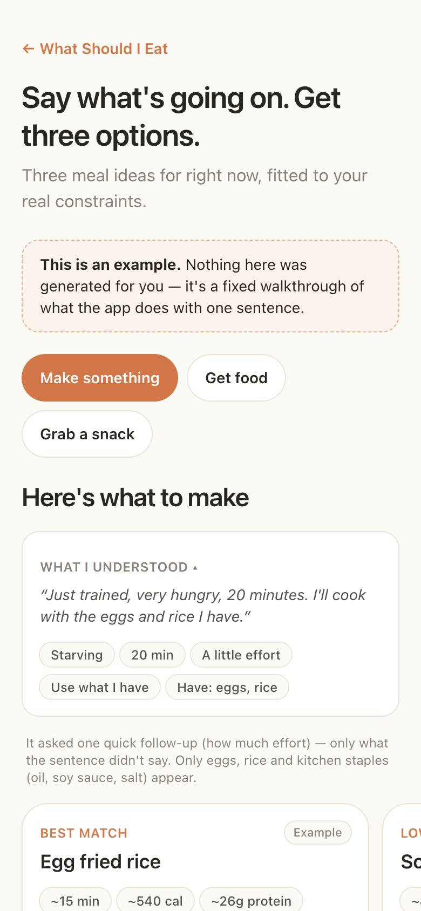
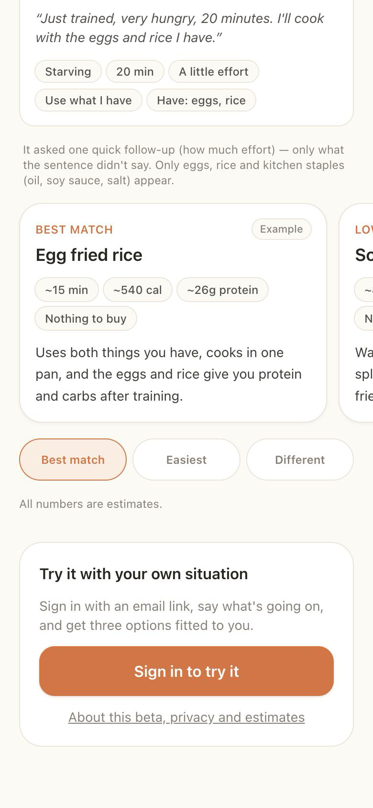
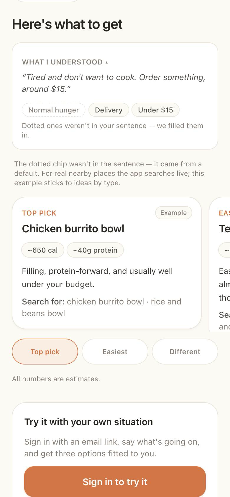
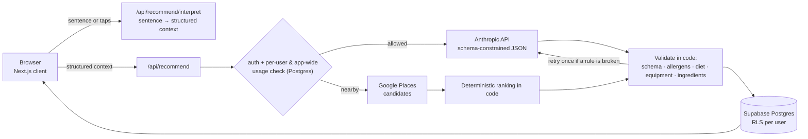

# What Should I Eat

**Decide what to eat right now, in one sentence.** Say *"just trained, very hungry, 20 minutes, I'll cook with the eggs and rice I have"* and get exactly **three** options that respect your real constraints: allergies, diet, equipment, what is actually in your kitchen tonight, time, effort and budget.

**[Live app](https://food-decision-mvp.vercel.app/)** · **[No-sign-up demo](https://food-decision-mvp.vercel.app/demo)** · [About, privacy and limits](https://food-decision-mvp.vercel.app/about) · [Case study](docs/CASE_STUDY.md)

> **Status: public beta.** Built and automatically tested; not yet validated with real users, so no usage numbers are claimed. Nutrition figures are AI estimates, and the allergy checks are not a safety guarantee. See [Limits](#limits-stated-plainly).

<p>
  
  
  
</p>

*Screenshots are the public `/demo` page: a fixed, labelled example, so nothing in them is personal or generated for a real person.*

## The problem

People do not lack recipes; they lack a *decision*. A recipe app returns a hundred options and a calorie tracker returns a ledger. The question is narrower: **given my real constraints right now, what should I actually eat?** Success is measured by whether the person ate one of the three, not by time in the app.

It is deliberately **not** a recipe database, a calorie tracker, a meal planner or a nutrition coach.

## How it works



One request becomes exactly three *decisions*, each with a different purpose (best match, easiest, a meaningfully different option). Three ways of getting food are one system, not three products: **cook**, **get food** (order or nearby) and **grab a snack**, plus an *open* request that mixes them.

## Key engineering decisions

| decision | why | trade-off |
|---|---|---|
| **The model is a function, not a chatbot.** The server builds a structured context and the model returns JSON that is schema-validated before any UI sees it. | A bad answer fails visibly instead of rendering half a card. | No free-form conversation. |
| **Hard constraints are enforced twice**: stated separately in the prompt, then checked in code on the answer (allergen names, dietary pattern, equipment, "no cooking at all"). A violating set is rejected and retried once. | A model is persuasive, not reliable. Safety-relevant rules should not rest on it alone. | The check is a literal word match: it can miss aliases and hidden ingredients. The app says so. |
| **No invented ingredients.** Available = what you listed *for this meal* + persistent kitchen staples. "Use what I have" may return fewer than three, or a purchase fallback. | A recipe that quietly assumes an ingredient is worse than a short, honest list. | Sometimes the honest answer is "buy a few things". |
| **Code picks the places; the model only words them.** Nearby results come from deterministic ranking over real candidates. | A model can hallucinate a restaurant; a ranking rule cannot. | Less creative than model ranking. |
| **Preferences have provenance** (explicit, remembered, fallback). One choice never becomes a permanent preference; not choosing is never dislike. | Nothing inferred is presented as the person's own. | Slower to feel personalised. Rules only: no trained model. |
| **Cost control lives in Postgres, before the paid call.** One atomic function enforces a per-person daily limit, an app-wide ceiling and an owner's off switch, and only the server role can execute it. | In-memory counters reset on cold starts, per-account limits alone do not stop many accounts, and a function the browser can call lets it choose its own limit (an earlier version did; found and closed in review). | These are the app's limits, not a billing cap. Vendor-side spend limits are still required. |
| **Row Level Security is the authorization layer**, tested as two users and as signed out, for every user table. | The browser holds the public key by design. | Tests cover the shipped SQL on a local engine, not a particular hosted project. |
| **Privacy by construction.** Product events and logs carry names, codes and timings, never what a person typed, foods, health details or location. | You cannot leak what you never record. | Less debugging detail; errors carry a short reference id. |

More evidence for each decision, and what it does *not* prove, is in the [case study](docs/CASE_STUDY.md).

## Tech stack

Next.js 15 (App Router) · TypeScript (strict) · Tailwind CSS v4 · Supabase (Postgres, Auth magic link, Row Level Security, Storage) · Anthropic API · Google Places API (New) · Cloudflare Turnstile · Vercel · Vitest, PGlite (real Postgres engine in tests), ESLint.

## Testing

```bash
npm run typecheck   # tsc --noEmit
npm run lint        # eslint
npm test            # 1,346 tests in 93 files
npm run build       # production build
```

- **Unit and route tests** cover output validation, the constraint checks, the sentence reader, usage limits and every paid route's refusal paths (signed out, cross-site, over limit, paused).
- **Real-Postgres tests (PGlite)** run the shipped `supabase/schema.sql` and migrations: two-account isolation over every user-owned table, the usage meter under concurrency (exactly *N* of 40 simultaneous calls allowed), server-only writes to the shared picture cache, and migration idempotency in any order.
- **Opt-in real-model checks** (cost real money, never part of `npm test`): `npm run check:interpret` and `npm run check:open` re-check allergy, no-cooking and no-invented-ingredient rules against live model output; `npm run bench:recommend` measures latency and cost. The benchmark was small (two runs per case), so it is an indication, not a performance claim.
- **Reproducible install.** `package.json` pins Vitest's native bundler binding for the common platforms under `optionalDependencies`: npm (11.x) omits optional binaries of auto-installed peer dependencies when installing from the lockfile ([npm/cli#4828](https://github.com/npm/cli/issues/4828)), which made a clean `npm ci && npm test` fail. The same bug left Vite's nested `lightningcss` and `fsevents` without their platform entries in `package-lock.json`, which npm 10 (the version bundled with Node 22) rejects; those entries are now in the lockfile. Remove the pins once that is fixed upstream.
- **CI** runs typecheck, lint and tests on every push and pull request ([`.github/workflows/ci.yml`](.github/workflows/ci.yml)).

## Run it locally

Requires Node 20+ and a free Supabase project.

```bash
npm install
cp .env.local.example .env.local     # fill in the values; every variable is explained inside
npm run dev                          # http://localhost:3000
```

1. Create a Supabase project and run `supabase/schema.sql` in the SQL editor (idempotent).
2. Put the project URL and anon key in `.env.local`. Add `ANTHROPIC_API_KEY` for recommendations. Google Places, Pexels and OpenAI keys are optional and the app degrades without them.
3. Under *Authentication → URL Configuration*, allow `http://localhost:3000/**`. Supabase's built-in email sender is limited to a couple of emails an hour to your own team; use *Authentication → Users → Send magic link* while developing.

Dev-only pages (404 in production): `/dev/home` runs the real Home screen against a fake network, and `/dev/carousel` exercises picture loading. Deploying and operating it (migrations, environment variables, spend caps, the off switch) is in [`docs/RELEASE.md`](docs/RELEASE.md).

## Limits, stated plainly

- Calories, protein, cost and time are **estimates** from a model and are shown with a "~". Prices and place details can be out of date.
- Allergen and diet checks are **literal word matches**. They are not a safety guarantee, and the UI says to check ingredients, labels and cross-contact yourself.
- It is not medical or dietetic advice.
- No user study has been run. "Do people eat one of the three?" is a hypothesis, tracked in [`docs/LEARNINGS.md`](docs/LEARNINGS.md).
- The brand name is a placeholder (`src/lib/brand.ts`).

## Documentation

| file | what it covers |
|---|---|
| [`docs/CASE_STUDY.md`](docs/CASE_STUDY.md) | The problem, technical decisions with evidence and their limits, built vs. unvalidated |
| [`docs/PRODUCT.md`](docs/PRODUCT.md) | Product thesis, principles, scope and non-goals |
| [`docs/PLAN.md`](docs/PLAN.md) | Roadmap: now / next / later |
| [`docs/PERSONALIZATION.md`](docs/PERSONALIZATION.md) | How the product remembers and learns (rules, not a trained model) |
| [`docs/LEARNINGS.md`](docs/LEARNINGS.md) | Evidence log: observations, hypotheses, what would change them |
| [`docs/RELEASE.md`](docs/RELEASE.md) | Deploying and operating the beta |
| [`CLAUDE.md`](CLAUDE.md) | Working rules for AI-assisted development in this repo |
| [`SECURITY.md`](SECURITY.md) | Reporting a vulnerability; security model in brief |

This project was built with an AI coding assistant working under the rules in `CLAUDE.md` and the product documents above; the commit history shows it.
